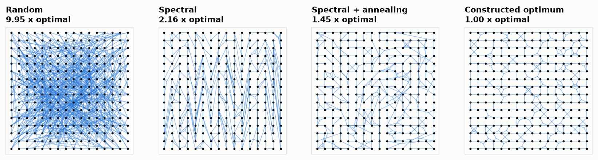
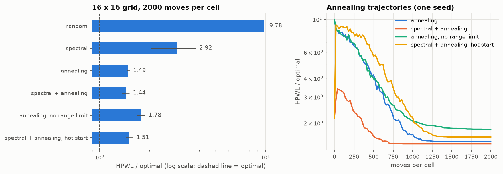
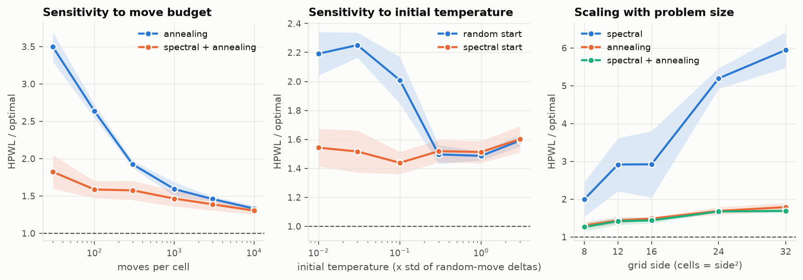

# vlsi-placer

[](https://github.com/Soham-Padalkar/vlsi-placer/actions/workflows/ci.yml)

Cell placement algorithms — **spectral (quadratic) placement** and **simulated annealing** — measured against benchmarks whose optimal wirelength is known by construction, so each result is reported as "× optimal" instead of only relative to another heuristic.



*The same 256-cell netlist placed four ways. Lines join each net's pins to their centroid.*

## Problem

Placement decides where each cell of a chip goes; total wirelength is the standard first-order proxy for delay, power and routability. The problem is NP-hard, so every practical placer is a heuristic, and comparing heuristics only with each other says nothing about how far any of them is from the best possible answer. This project measures that gap directly.

## Method and why

**Benchmarks with a known optimum.** Following the idea of the PEKO suite (Chang, Cong and Xie, 2003), a hidden placement is chosen first and nets of 2–4 pins are created only where their pins sit in the tightest possible bounding box. Each net is then at its individual lower bound, so the hidden placement is provably optimal. Cell numbers are shuffled before the netlist is handed to a placer. On a grid small enough to enumerate (2 × 4, all 40 320 permutations) a test confirms that nothing beats the constructed optimum.

**Algorithms.**

| Method | Role | Idea |
|---|---|---|
| Random | floor | a random permutation |
| Spectral | fast analytic baseline | x and y from the 2nd and 3rd eigenvectors of the netlist Laplacian (Hall, 1970), then legalized by sorting into columns |
| Simulated annealing | iterative refinement | pairwise swaps, incremental wirelength update, range-limited moves, geometric cooling |
| Spectral + annealing | hybrid | annealing started from the spectral result at a low temperature |

Spectral placement was chosen as the analytic method because it needs no fixed pads, which these benchmarks do not have. Annealing was chosen because it is the classic approach for swap-based placement and its two main refinements can be switched off individually to measure what each contributes.

```
src/placer/
  netlist.py      netlist, HPWL, per-net lower bounds
  benchmark.py    known-optimum benchmark generator
  spectral.py     Laplacian, eigenvector coordinates, legalization
  anneal.py       simulated annealing with incremental HPWL
  experiments.py  every experiment and figure in this README
```

## Setup

```bash
python -m venv .venv && source .venv/bin/activate   # Windows: .venv\Scripts\activate
pip install -r requirements.txt && pip install -e .
pytest                                # 16 tests, ~3 s
python -m placer.experiments --quick  # ~1 min smoke run
python -m placer.experiments          # full results, ~10 min of pure-Python annealing
```

Seed *s* generates benchmark *s* and seeds the annealer; experiments use seeds 0–4.

## Results

From `docs/figures/results.json`; wirelength divided by the optimum (1.00 is optimal), mean ± standard deviation over 5 benchmarks, 16 × 16 grid, 2000 moves per cell.

| Method | HPWL / optimal | Time (s) |
|---|---|---|
| Random | 9.78 ± 0.27 | < 0.01 |
| Spectral | 2.92 ± 0.88 | < 0.01 |
| Annealing | 1.49 ± 0.03 | 2.5 |
| **Spectral + annealing** | **1.44 ± 0.08** | 2.4 |
| *Ablation:* annealing without range limiting | 1.78 ± 0.10 | 2.7 |
| *Ablation:* spectral + annealing, hot start | 1.51 ± 0.08 | 2.4 |



- **Nothing reaches the optimum.** The best result is still 44 % above it, and 30 % above even with a 5× larger budget. That matches the qualitative finding of the PEKO study that placers leave a large gap on such benchmarks.
- **Range limiting is the component that matters**: removing it costs 0.29× optimal, far outside the seed spread.
- **The spectral start helps much less than expected at this budget** (1.44 vs. 1.49, overlapping within one standard deviation). Its benefit is real at small budgets — at 30 moves per cell the hybrid reaches 1.82 where plain annealing is at 3.50 — and it is wasted entirely by a hot start, which melts the initial placement.
- **Sensitivity to temperature.** From a random start the initial temperature must be at least 0.3× the spread of random-move cost changes (2.0–2.3× optimal below that). From a spectral start the result is nearly flat across two orders of magnitude.
- **Scaling.** At a fixed budget per cell the gap widens with size: annealing goes from 1.31× optimal at 64 cells to 1.79× at 1024, and spectral placement alone from 2.0× to 5.9×.



## Limitations

- **Idealised problem.** Unit-size cells on a full grid, no fixed pads or macros, no row structure, and wirelength only: no timing, congestion or density objectives. Real placement is considerably harder.
- **Constructed benchmarks are not real circuits.** Every net is purely local in the optimal solution, which real netlists are not, so the measured gaps should not be read as gaps on industrial designs.
- Largest instance is 1024 cells; modern analytic placers (ePlace, RePlAce, DREAMPlace) handle millions and are not implemented here.
- The annealer is pure Python (about 5 µs per move), which limits budgets; the hybrid's small advantage at 2000 moves per cell is not statistically separated from plain annealing with 5 seeds.
- The legalizer is a simple sort and accounts for a good part of the spectral method's 2.9× result.

## Next steps

- Read a standard format (Bookshelf / ISPD) and run on public benchmarks.
- A density-aware analytic placer (electrostatic formulation) as a stronger baseline.
- Port the inner loop to a compiled kernel to reach 10⁴–10⁵ cells.
- A better legalizer (Abacus- or Tetris-style) for the spectral start.

## References

- C.-C. Chang, J. Cong, M. Xie, "Optimality and scalability study of existing placement algorithms," *ASP-DAC* 2003.
- K. M. Hall, "An r-dimensional quadratic placement algorithm," *Management Science* 17(3), 1970.
- S. Kirkpatrick, C. D. Gelatt, M. P. Vecchi, "Optimization by simulated annealing," *Science* 220, 1983.

MIT licensed.
